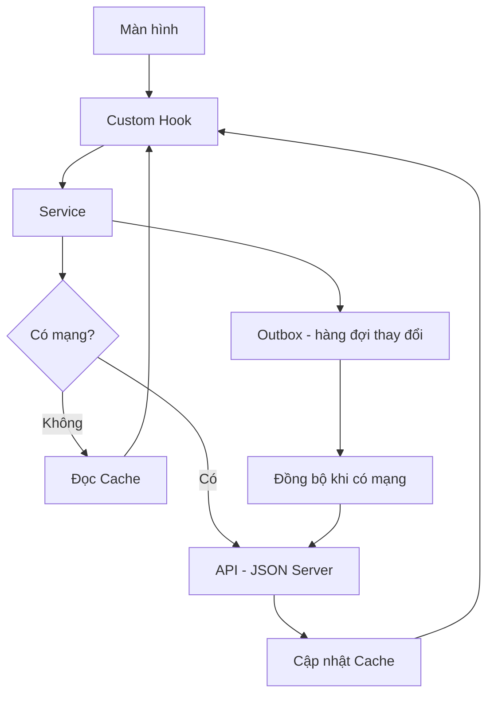

# Ứng dụng quản lý học tập

Ứng dụng di động được xây dựng bằng React Native CLI, hỗ trợ xem lịch học, môn học, bài tập, điểm số và thông tin cá nhân. Dữ liệu được lấy từ REST API sử dụng JSON Server và có hỗ trợ lưu cache để xem dữ liệu khi offline.

## 1. Công nghệ sử dụng

- React Native CLI
- JavaScript
- React Navigation
- JSON Server
- AsyncStorage
- NetInfo
- Android Emulator

## 2. Yêu cầu môi trường

Cài đặt các công cụ sau trước khi chạy dự án:

- Node.js và npm
- JDK phù hợp với phiên bản React Native
- Android Studio và Android SDK
- Android Emulator hoặc thiết bị Android
- Git

Tham khảo hướng dẫn thiết lập môi trường chính thức: https://reactnative.dev/docs/set-up-your-environment

## 3. Cài đặt dự án

Clone repository:

```bash
git clone https://github.com/Bui-Hai-Nam-1/baitaptuan3.git
cd baitaptuan3
```

Cài đặt các thư viện:

```bash
npm install
```

## 4. Khởi chạy JSON Server

Mở một terminal tại thư mục gốc của dự án và cài JSON Server phiên bản 0.17.4 nếu máy chưa có:

```bash
npm install -g json-server@0.17.4
```

Khởi chạy API từ file `db.json`:

```bash
json-server --watch db.json --host 0.0.0.0 --port 3000 --delay 800
```

Giữ terminal này mở trong suốt quá trình sử dụng ứng dụng.

Các endpoint chính:

- `GET /students`
- `GET /courses`
- `GET /sessions`
- `GET /assignments`
- `GET /grades`

Trên Android Emulator, ứng dụng truy cập API thông qua địa chỉ `http://10.0.2.2:3000`.

## 5. Chạy ứng dụng Android

Mở terminal thứ hai tại thư mục dự án và khởi chạy Metro:

```bash
npm start
```

Giữ Metro đang chạy. Mở terminal thứ ba, sau đó chạy:

```bash
npm run android
```

Đảm bảo Android Emulator đã khởi động hoặc thiết bị Android đã được kết nối trước khi chạy lệnh.

## 6. Kiểm tra chức năng offline

1. Khởi chạy JSON Server và ứng dụng khi có mạng.
2. Mở các màn hình cần kiểm tra để dữ liệu được tải và lưu cache.
3. Dừng JSON Server bằng `Ctrl + C` trong terminal đang chạy JSON Server.
4. Giữ Metro hoạt động và tải lại màn hình trong ứng dụng.
5. Kiểm tra dữ liệu đã lưu cache có hiển thị khi API không truy cập được hay không.

Kết quả offline phụ thuộc vào dữ liệu đã được cache trước đó. Các thao tác cập nhật dữ liệu khi offline có thể cần cơ chế đồng bộ riêng.

## 7. Cấu trúc thư mục chính

```text
baitaptuan3/
├── android/
├── src/
│   ├── api/
│   ├── config/
│   ├── data/
│   ├── hooks/
│   ├── navigation/
│   ├── screens/
│   └── storage/
├── db.json
├── App.tsx
├── package.json
└── README.md
```

## 8. Xử lý lỗi thường gặp

- **Không kết nối được API:** Kiểm tra JSON Server có đang chạy ở cổng `3000` không.
- **Android Emulator không truy cập được API:** Kiểm tra địa chỉ API trong `src/config/index.js`; Android Emulator thường dùng `http://10.0.2.2:3000`.
- **Ứng dụng không chạy:** Kiểm tra môi trường React Native, Android SDK và chạy lại `npm install` nếu cần.
- **Dữ liệu offline không hiển thị:** Mở ứng dụng khi API hoạt động trước để tạo cache.

## 9. Tài liệu tham khảo

- React Native: https://reactnative.dev/
- React Navigation: https://reactnavigation.org/
- JSON Server: https://github.com/typicode/json-server
## Luồng dữ liệu và xử lý xung đột (B5)

### 1. Sơ đồ luồng dữ liệu



### 2. Vai trò của từng thành phần

- **Màn hình (Screen):** Hiển thị dữ liệu và nhận thao tác của người dùng.
- **Custom Hook:** Quản lý trạng thái tải dữ liệu, dữ liệu hiển thị, lỗi và thao tác làm mới.
- **Service:** Gọi API, xử lý dữ liệu và phối hợp việc lưu hoặc đọc cache.
- **Cache:** Lưu dữ liệu đã tải để có thể hiển thị khi API không truy cập được.
- **Outbox:** Hàng đợi lưu các thao tác ghi dữ liệu chưa đồng bộ lên máy chủ.
- **API:** JSON Server cung cấp dữ liệu và xử lý các yêu cầu đọc, thêm hoặc cập nhật dữ liệu.

### 3. Cách xử lý xung đột dữ liệu (B5)

Khi ứng dụng hoạt động offline, dữ liệu trên thiết bị có thể khác dữ liệu trên máy chủ do người dùng hoặc thiết bị khác đã cập nhật.

Quy trình xử lý đề xuất:

1. **Lưu thay đổi:** Ghi thao tác cần đồng bộ vào Outbox, gồm mã bản ghi, dữ liệu thay đổi và thời điểm tạo thao tác.
2. **Đồng bộ lại:** Khi có mạng, gửi các thao tác trong Outbox lên API theo thứ tự phù hợp.
3. **Kiểm tra xung đột:** So sánh phiên bản hoặc thời điểm cập nhật của bản ghi trên thiết bị và máy chủ.
4. **Giải quyết xung đột:** Nếu cả hai phía đều đã thay đổi cùng một bản ghi, áp dụng quy tắc được xác định trước. Có thể ưu tiên dữ liệu mới hơn nếu có timestamp đáng tin cậy; với dữ liệu quan trọng, nên yêu cầu người dùng lựa chọn.
5. **Cập nhật dữ liệu:** Sau khi đồng bộ thành công, cập nhật cache và xóa thao tác tương ứng khỏi Outbox.
6. **Xử lý lỗi:** Nếu đồng bộ thất bại do mất mạng hoặc lỗi máy chủ, giữ thao tác trong Outbox để thử lại sau.

### 4. Lưu ý về triển khai

Cache giúp đọc dữ liệu khi offline, nhưng bản thân cache không đảm bảo đồng bộ các thay đổi khi có mạng trở lại. Outbox và cơ chế phát hiện, giải quyết xung đột cần được triển khai riêng nếu ứng dụng hỗ trợ chỉnh sửa dữ liệu offline.

JSON Server mặc định không cung cấp cơ chế kiểm soát phiên bản và giải quyết xung đột đầy đủ. Vì vậy, nếu cần bảo đảm tính nhất quán trong môi trường nhiều thiết bị, cần bổ sung trường phiên bản hoặc timestamp và quy tắc đồng bộ phù hợp.
